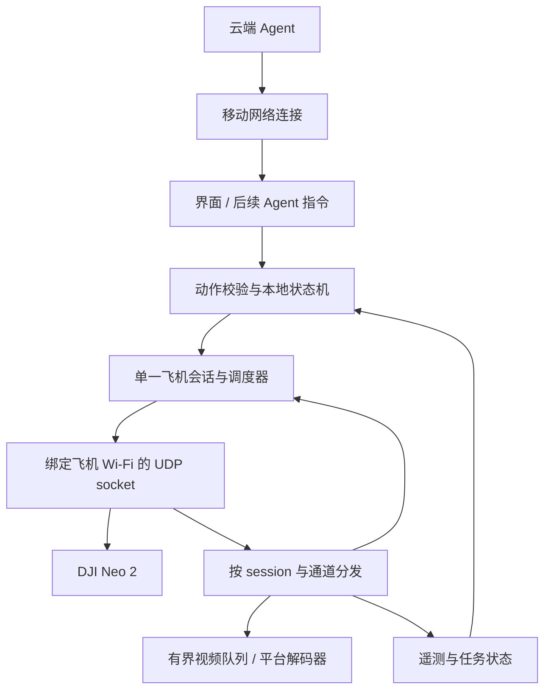

# 交给鸿蒙开发者的迁移指南

## 目标和边界

目标是用鸿蒙原生能力重建同一个 UDP 控制会话，复用本仓库的字节编码、注册应答、可靠传输、状态机和测试向量。**不是在手机上运行 Windows/Python 控制台，也不是把旧 `.ets` 页面复制进来就完成移植。**

本仓库没有附带可安装的鸿蒙程序、开发证书或已经验证的双网络适配。先确认手机型号、HarmonyOS 版本、DevEco Studio/SDK/API 级别，再选用该版本公开支持的接口。不要混用旧 `@ohos.*` 和不同版本 `@kit.*` 示例的类型与签名。

## 1. 建议的手机架构

只有 Session 对飞机发送数据；UI、Agent、视频解码器不各自创建控制 socket。断网、取消、回中和动作截止时间在手机本地执行，不依赖云端及时回包。

## 2. 按模块移植

| Python 参考 | 鸿蒙职责 | 移植重点 |
| --- | --- | --- |
| `duml.py`、`outer.py` | `DumlCodec`、`OuterCodec` | Uint8Array 编解码、CRC、长度和来源验证 |
| `handshake.py` | `HandshakeMachine` | 同一 socket 上有限重试、匹配 session 和短回复 |
| `fly_command.py`、`control_packets.py` | `CommandCodec` | 内层命令、包裹帧、严格回复匹配 |
| `reliable_transport.py` | `ReliableTransport` | 窗口、累计确认、序号回绕、原字节重传 |
| `registration_exchange.py`、`registration_schema.py` | `RegistrationMachine` | 读取模板、启动调度、实时请求序号应答 |
| `routing_sequences.py` | `RoutingCounterStore` | 跨重启 u32、单会话互斥、先持久化再使用 |
| `neutral_stick.py`、`initial_010a.py` | `StickCodec` | 11 位跨字节通道打包、u24 counter |
| `movement_commands.py` | `MotionLimits` | 八方向映射、时长边界；可不移植中文文本解析 |
| `landing_status.py`、`subject_observation.py` | `TelemetryStore` | 字段验证、时间戳、过期剔除、保留未知状态 |
| `circle_protocol.py`、`native_circle.py` | `NativeCircleTask` | 模式/参数回显和读回、显式确认、停止与取消 |
| `video_packets.py` | `VideoAssembler` | 完整分片、有界积压，交由手机解码器处理 |
| `flight_controller.py` | `DroneSession` | 集成、并发、动作权限、断链处理和生命周期 |

模块名是建议，不要求逐文件机械翻译。协议和状态判断先保持等价，平台接口再单独适配。

## 3. 先解决网络适配，不先做飞行界面

### 飞机网络

1. 用户手动加入飞机热点，并选择保留没有互联网的 Wi-Fi 连接。
2. 通过目标 SDK 的网络管理能力找到飞机 Wi-Fi 的网络句柄、本机 IP 和连接变化。不要从云端连接的默认网络 IP 推断飞机网卡。
3. 采用该 SDK 支持的 socket/网络绑定方式，把控制 UDP 固定在此 Wi-Fi；在该网卡本机 IP、临时端口绑定。IP 地址绑定和网络路径绑定是两个需要分别验证的概念。
4. 对 `192.168.2.1:9003` 建立同一 UDP 收发通道，注册接收回调后再握手。收到数据先验证 peer 和 session。
5. Wi-Fi 不具备公网能力，所以筛选飞机网络时不能强制要求公网验证成功。

### 移动数据和云端 Agent

目标是飞机 UDP 使用 Wi-Fi、云端连接使用移动网络。不能以“状态栏同时出现两个图标”作为程序分流成功的证据，也不能把整个进程绑定 Wi-Fi 后期待 Agent 自动走流量。

需要在具体设备上验证：网络句柄能否同时获得与保持、公开 API 和权限是否支持所需绑定、HTTP/WebSocket 客户端如何选择网络、Wi-Fi 无公网时会不会被系统断开。**本项目当前只提出此架构，没有完成手机双网络测试。** 如果某 API 是系统接口或需特殊授权，先确认应用资格，不把它当普通三方 App 可用。

起步声明通常涉及 INTERNET 和网络信息读取，是否需要额外权限取决于 SDK、所调用接口和系统版本；按官方接口要求配置 `module.json5`。只读已连接网络不等于需要扫描周围热点，不预先添加与功能无关的权限。

官方文档入口（以目标 SDK 的实际签名与权限为准）：

- [网络连接管理](https://developer.huawei.com/consumer/cn/doc/harmonyos-references/js-apis-net-connection)
- [Socket 连接指南](https://developer.huawei.com/consumer/cn/doc/harmonyos-guides/socket-connection)
- [较早版本网络 API 参考，注意版本差异](https://developer.huawei.com/consumer/en/doc/harmonyos-references-V3/js-apis-net-connection-0000001333720849-V3)

这些链接用于核对平台接口，不构成本项目已经在该平台验证成功的证明。

## 4. 二进制移植常见错误

- Python 整数不限位宽；JS/ArkTS 普通位运算按 32 位处理。四轴合计跨过 64 位，**不要把整个 28 字节 payload 转成 Number 后整体移位**。使用逐位写入 Uint8Array，或拆成逐字节位域。
- u32 counter 需用无符号表示；u16 序号比较用差值取模，不用普通 `a > b` 判断回绕后新旧。
- DataView 读取 u16/u32/float32 时明确传 `littleEndian=true`。二进制包不要通过 UTF-8 字符串中转。
- CRC 用本仓库的初值、反射多项式与字节顺序，不能仅按“CRC16”名称选择一个默认库算法。
- 发生重传时发送旧字节数组副本，不能重新分配 seq 或修改其 counter、时间戳和 CRC。

## 5. 计时、并发和存储

Python 有两个常驻线程：接收处理与发送/重传 tick。手机端可改为串行事件调度与独立视频 worker，但必须保持下面的语义：

| 项目 | 当前参考 |
| --- | --- |
| tick | 默认约 60ms；当前可配置范围 20–200ms |
| 注册 heartbeat | 约 200ms |
| 可靠重传 | 约 150ms；未确认累计寿命 1s |
| 下行/视频新鲜度 | 起飞等权限检查约 1s |
| 单方向动作 | 默认 0.5s，最大 10s，结束或取消回中 |

截止时间和重传使用单调时钟；日志时间可以用墙上时钟。不要因用户修改系统时间而延长动作。

降落与取消优先于长动作或参数等待；参数准备和起飞在**最终发送前**还要检查同一取消 token。旧任务结束时不得把新任务的取消标志清掉。接收回调中不要同步解码视频、写大文件或等待云端。

`.state/routing-sequence.json` 中的完整 counter、版本和身份校验必须迁移。原代码一次预留一段号码，先写盘再使用，崩溃后跳过未用号码。鸿蒙中可用满足原子更新/持久化要求的本地存储替换文件；同时只允许一个会话使用同一身份。

前后台切换、锁屏、系统省电可能影响连接与计时。先验证前台工作；后台需求另按平台允许的任务机制实现并实测，不把 UI 定时器当可靠飞控调度器。

## 6. 分阶段验收

### A：离线编码

把 `samples/golden-vectors.json` 的参数输入鸿蒙编码器，输出 hex 与期望逐字节一致。覆盖握手、DUML CRC、包裹起飞、八方向 payload、半径和停止零长度 payload。加入坏长度、CRC、错 session 与 u16 回绕测试。

### B：连接和状态，不飞行

取得 Wi-Fi 网络，完成握手，保持注册/可靠传输；显示设备回复、三组游标、待确认包数和遥测年龄。反复退出重连仍使用递增路由 counter。视频暂只统计收包与组帧，不接大界面。

### C：设备本地动作

对照 `STATE_AND_API.md` 实现起降和短时方向动作，逐项验证回中、取消、降落优先、断链拒绝动作。操作者确认落地并取得新鲜遥测后再启新一轮。

### D：环绕和接续

先做 2 米模式/参数读回，再确认启动；区分请求 ACK、主体候选和任务执行。验证停止后悬停、八方向接管、落地重飞。其他半径逐项测试，不把参数读回当成实际圆周半径精度证明。

### E：图传、双网络和 Agent

HEVC 解码、参数集变化、丢参考链恢复分别验证；最后再接云端和语音。Agent 只产生限定动作参数，手机端检查权限与时长，保留本地停止/降落入口。

## 7. 交接时另给什么

同设备接续开发需在仓库外转交**最新**路由状态，确认原程序已退出。需要复现历史现场问题时，另行提供经检查的抓包和实际操作时间线；它们没有放入此精简仓库。新设备不能无条件复用现有注册身份。
